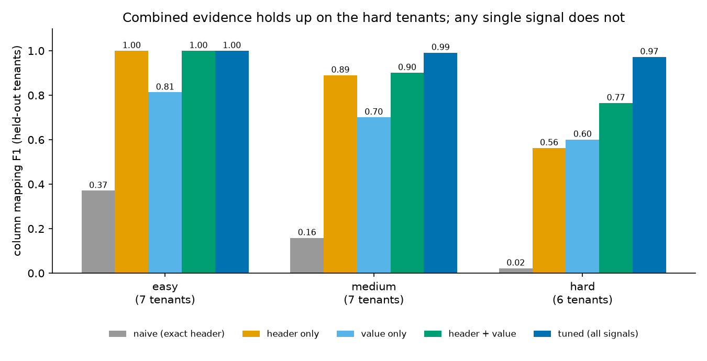
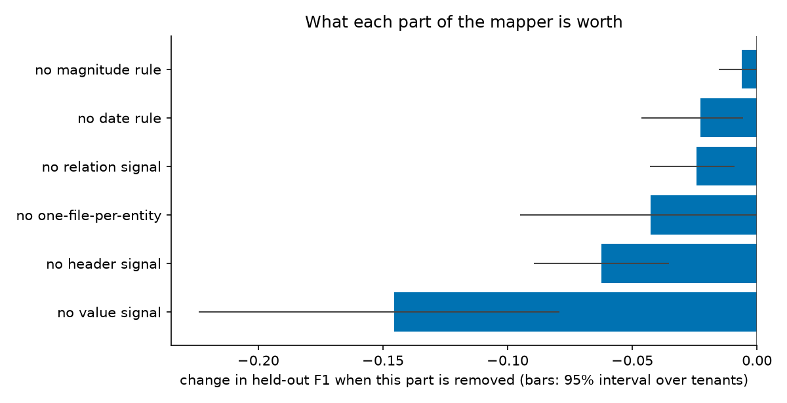
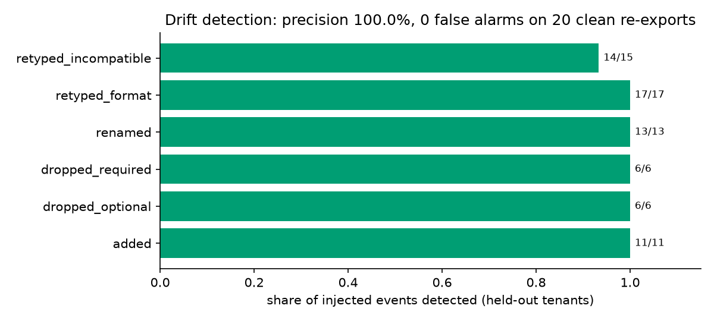

# 🧰 Tenant Onboarding Kit

What happens in the first two weeks after a customer signs: they send exports from their own system, and every one of them is different. Different column names (in different languages, or just `C3`), different file formats, delimiters and encodings, dates written four ways, amounts written six ways, title lines above the header and totals below the data, the same key twice with different content, and no schema document.

This project is the part of that job that can be built once: read whatever arrives, propose a mapping to a canonical schema (customers, invoices, payments) with evidence, hand a person a **reviewable config file**, load the data **idempotently** into a ledger you can dry-run and roll back, write a **data-quality report** that leaks no customer values, and notice **schema drift** in later exports before it corrupts anything. Everything is measured on 40 synthetic tenants whose right answers are known.

It runs on a laptop CPU with the standard library alone (matplotlib and pytest are only for charts and tests). No model is needed. A language-model arbiter for the few ambiguous columns is a plug-in, off by default.

All data is synthetic and generated here. No real customer, invoice or person is involved, and none of it comes from any employer. This is original code.

## What is in the pipeline

```
customer export files (CSV, TSV, JSON, NDJSON; any of utf-8, utf-8-sig, cp1252, latin-1, utf-16)
   │
   ▼
readers ──────── encoding and delimiter sniffing, title lines / footers / repeated headers dropped, nested JSON flattened to dotted paths
   │
   ▼
profile ──────── per column: how many cells look like an email / date / amount / known status word, shape, cardinality,
   │             a small hashed sketch of the values (so two columns can be compared without keeping the values)
   ▼
mapper ───────── three kinds of evidence per (column, canonical field), combined and assigned one-to-one:
   │               header    the name, via a small multilingual lexicon plus fuzzy matching
   │               value     does the content look like that field's type
   │               relation  keys are unique and get referenced; foreign keys sit inside another file's key column
   │             + each file assigned to the entity it fits, a tenant's files assigned jointly
   │             + two tie-break rules (which of several dates is the issue date; which of several amounts is the total)
   │             + an optional arbiter, asked only about columns the rules leave ambiguous
   ▼
config (JSON) ── per column: target, confidence, needs_review, transform (date format, decimal separator, status vocabulary...),
   │             per tenant: drift policy and thresholds, a fingerprint of every column      ◀── a person reviews and edits this
   ▼
normalize ────── canonical records; a row with a bad required field is quarantined, with a reason and never a value
   │
   ▼
validate ─────── data-quality report: completeness, duplicates, quarantine, broken references, decision ok / warn / block
   │
   ▼
drift check ──── dropped / added / renamed / retyped columns against the config's fingerprints, each with a policy: heal / alert / block
   │
   ▼
ingest ───────── SQLite ledger: upserts keyed by (tenant, entity, key), one transaction per file, checkpoints, dry run, resume, rollback
```

## How the evaluation is kept honest

- **Known right answers.** The generator writes `truth.json` next to every tenant: which source column is which canonical field, and what each record should look like after normalization. The mapper never reads it; only `evaluate.py` does.
- **One split, made once.** Tenants are split with a fixed seed (stratified by difficulty) into 20 for tuning and 20 held out. The tuning functions take the tuning tenants and nothing else. A test poisons every held-out label and checks the chosen settings cannot move; a second test poisons the *tuning* labels to show the poison would matter if it got through. `eval --dev`, used while changing code, never opens a held-out truth file (also tested).
- **Named baselines.** An exact-header-match baseline, header only, value only, and header plus value. Each simpler system gets its own threshold tuned on the tuning tenants, so the comparison is not rigged by one shared setting.
- **Ablations.** Each part of the tuned mapper is removed in turn and the held-out change reported with a 95% interval that resamples whole tenants.
- **Cost counts.** Among settings within 0.003 F1 of the best, tuning picks the one that sends the fewest columns to a person, because review time is the real cost.
- **Everything tried is on disk.** `results/trials.jsonl` has one line per configuration.
- **The vocabulary leak is measured, not hidden.** The mapper's lexicon (`schema.py`) and the generator's header vocabulary (`generate.py`) are written by the same person, which would let the mapper "find" what it was told. So the generator has a second tier of header words, in other languages and internal jargon, that the lexicon has never seen. `lexicon_coverage` counts the mapped columns whose header contains no word the lexicon knows: 23.8% overall, 0% in the easy tenants, 65.8% in the hard ones. That narrows the leak. It does not close it, and the limits section says so.
- **Disclosed fixes.** Bugs found along the way, including one found *after* the first held-out run, are listed below.

<!-- RESULTS:START -->







### Setup

| | |
|---|---|
| Tenants | 40 synthetic: 20 tuning, 20 held out (split once, seed 20261016, stratified by difficulty) |
| Generator seed | 7 |
| Mapped columns whose header has no word the lexicon knows | 157 of 659 (23.8%), all tenants |
| Tuned on | tuning tenants only; settings in `results/tuned_params.json`, every trial in `results/trials.jsonl` |
| Python | 3.13.13 |

### Column mapping on held-out tenants

Micro-averaged over columns. Interval: 95%, resampling whole tenants. Each simpler system had its own threshold tuned on the tuning tenants.

| System | Precision | Recall | F1 (95% interval) | Entity right | easy F1 | medium F1 | hard F1 |
|---|---|---|---|---|---|---|---|
| naive (exact header) | 1.000 | 0.119 | 0.212 (0.124 to 0.297) | 66.7% | 0.371 | 0.159 | 0.022 |
| header only | 0.952 | 0.787 | 0.861 (0.776 to 0.932) | 91.7% | 1.000 | 0.890 | 0.563 |
| value only | 0.708 | 0.723 | 0.715 (0.654 to 0.777) | 93.3% | 0.813 | 0.701 | 0.601 |
| header + value | 0.892 | 0.908 | 0.900 (0.831 to 0.961) | 95.0% | 1.000 | 0.901 | 0.765 |
| tuned (all signals) | 0.988 | 0.991 | 0.989 (0.978 to 0.999) | 100.0% | 1.000 | 0.991 | 0.972 |

The same systems on the tuning tenants (the data the settings were chosen on, so optimistic): naive (exact header) 0.145, header only 0.824, value only 0.705, header + value 0.917, tuned (all signals) 0.989.

### What each part is worth

Held-out F1 with one part of the tuned mapper removed.

| Removed | F1 | Change | 95% interval of change |
|---|---|---|---|
| no value signal | 0.844 | -0.146 | -0.224 to -0.079 |
| no header signal | 0.927 | -0.062 | -0.089 to -0.035 |
| no one-file-per-entity | 0.947 | -0.043 | -0.095 to +0.000 |
| no relation signal | 0.965 | -0.024 | -0.043 to -0.009 |
| no date rule | 0.967 | -0.023 | -0.046 to -0.006 |
| no magnitude rule | 0.983 | -0.006 | -0.015 to +0.000 |

### Human review

The mapper flags 21 of 329 mapped columns (6.4%) for a person to look at (low confidence, a close second choice, or decided by a tie-break rule). 0.0% of the 4 wrong predictions are among the flagged columns, and 1.3% of the unflagged columns are wrong.

### Normalization

Records found and field values equal to the truth, on the held-out tenants' first export. 'Oracle mapping' uses the true mapping, so it isolates the transform layer; 'predicted mapping' adds the mapper's mistakes.

| | Records found | Field accuracy | Rows loaded that should not be | Junk rows held back |
|---|---|---|---|---|
| oracle mapping | 100.0% | 99.3% | 0 | 100.0% |
| predicted mapping | 95.1% | 99.1% | 116 | 100.0% |

Wrong field values with the oracle mapping, by field: invoice.status 119, customer.country 63, payment.method 43. These are the limits of the transform layer: status and payment-method words and country names outside the vocabulary, and amounts in minor units (cents) in files with no header that says so.

### Schema drift

Each held-out tenant has a second export with 3 or 4 injected changes (renamed, added, dropped, retyped columns) and a clean re-export with new and changed rows but no schema change. Rename threshold 0.7, chosen on the tuning tenants.

| Config built from | Events found | Precision | Recall | Syncs decided right | Unsafe misses | False alarms on clean re-exports |
|---|---|---|---|---|---|---|
| oracle mapping | 68 | 1.000 | 0.985 | 100.0% | 0 of 17 | 0 events, 0 false blocks (20 syncs) |
| predicted mapping | 68 | 1.000 | 0.985 | 100.0% | 0 of 17 | 0 events, 0 false blocks (20 syncs) |

Detected by kind (predicted mapping): added 11/11, dropped_optional 6/6, dropped_required 6/6, renamed 13/13, retyped_format 17/17, retyped_incompatible 14/15.

In the 17 exports that should be blocked and were, loading them with the old config would have written 1,784 wrong or missing field values out of 18,475 (9.7%).

### Ingest guarantees

Run on the held-out tenants with the true mapping, so the ledger is tested rather than the mapper: 100 of 100 checks pass.

| Check | Passed | Scenario actually occurred |
|---|---|---|
| idempotent | 20 of 20 | 20 of 20 |
| incremental | 20 of 20 | 20 of 20 |
| dry run | 20 of 20 | 20 of 20 |
| crash and resume | 20 of 20 | 20 of 20 |
| rollback | 20 of 20 | 20 of 20 |

<!-- RESULTS:END -->

## Run it

Python 3.10 or newer (tested on 3.13).

```bash
git clone https://github.com/Sup3rMar10/tenant-onboarding-kit.git
cd tenant-onboarding-kit
pip install -r requirements.txt

python -m tenantkit demo          # the whole flow on three synthetic tenants, offline, about a second
```

The pieces, on the three sample tenants in `sample/` (one per difficulty; each has `base/`, a later `control/` re-export and a `drift/` export):

```bash
python -m tenantkit map sample/t01/base --out t01.json        # mapping table on screen, reviewable config on disk
python -m tenantkit ingest sample/t01/base --config t01.json --db ledger.db --dry-run --report
python -m tenantkit ingest sample/t01/base --config t01.json --db ledger.db
python -m tenantkit drift  sample/t01/drift --config t01.json     # what changed since the config was built
python -m tenantkit ingest sample/t01/control --config t01.json --db ledger.db
python -m tenantkit ingest --db ledger.db --rollback 2            # last in, first out
```

The full evaluation (generates 40 tenants into `data/tenants`, tunes, scores, writes `results/`, about two minutes):

```bash
python -m tenantkit eval
python -m tenantkit report --readme README.md                      # rebuild charts, REPORT.md and the block above
python -m tenantkit eval --dev                                     # tune and score on the tuning tenants only
```

Using the pieces from Python:

```python
from pathlib import Path
from tenantkit.readers import read_table
from tenantkit.mapper import compute_signals, map_tenant
from tenantkit.config import build_config
from tenantkit.ingest import Ledger, ingest_tenant

files = sorted(Path("sample/t01/base").iterdir())
tables = [read_table(p) for p in files]
sig = compute_signals(tables)
cfg = build_config("t01", tables, map_tenant(sig), sig)

ledger = Ledger("ledger.db")
print(ingest_tenant(ledger, cfg, files, dry_run=True).dq.render())
```

The language-model hook is a plain function, as in the sibling project `rag-tuning-lab`:

```python
from tenantkit.llm import Arbiter

def llm(prompt: str) -> str:      # any function that takes a prompt and returns text
    ...

mapping = map_tenant(sig, arbiter=Arbiter(llm))     # asked only about ambiguous columns; may only pick a listed candidate
```

By default the prompt contains the column name, shape statistics and candidate fields, never a cell value (`send_samples=True` adds three masked samples). `AnthropicArbiter` wraps the Anthropic API and needs the optional `anthropic` package and an API key. **It has not been run against the live API in this project**; only prompt building, answer parsing and the guard rails (it cannot pick a non-candidate, cannot take a field another column owns, and is capped at a number of questions) are tested, with a fake model.

## The config file

This is a real excerpt from `python -m tenantkit map sample/t01/base`, a French-language invoice export with one column named `C3`:

```json
{"source": "invoiceNumber", "target": "invoice_id", "confidence": 0.993, "needs_review": false, "decided_by": "score",
 "transform": {"type": "id"}}
{"source": "total", "target": "amount", "confidence": 1.0, "needs_review": false, "decided_by": "score",
 "transform": {"type": "money", "decimal": ",", "scale": 1, "currency_in_value": true}}
{"source": "status", "target": "status", "confidence": 0.9766, "needs_review": false, "decided_by": "score",
 "transform": {"type": "status", "value_map": {"ANNULÉ": "void", "EN RETARD": "overdue", "OUVERT": "open", "PAYÉ": "paid"},
               "unmapped": ["PARTIEL"]}}
{"source": "C3", "target": "invoice_date", "confidence": 0.775, "needs_review": true, "decided_by": "score",
 "transform": {"type": "date", "format": "%d/%m/%Y", "ambiguous": false}}
{"source": "runId", "target": null, "suggestions": [{"target": "invoice.invoice_id", "score": 0.576}]}
```

It is meant to be edited. `PARTIEL` is a status word the mapper has no meaning for, so it is listed under `unmapped` and rows carrying it load with a null status and a count in the report until someone adds `"PARTIEL": "partial"` to `value_map`. `C3` carries no name evidence, so it is flagged. `load_config` validates in words: unknown field, a field mapped from two columns, a required field with no source (unless listed under `allow_missing`), an unknown date format, a policy action that is not heal, alert or block.

The drift policy is in the same file, so a customer's risk appetite is explicit:

```json
"drift_policy": {"renamed": "heal", "added": "alert", "dropped_optional": "alert", "dropped_required": "block",
                 "retyped_format": "heal", "retyped_incompatible": "block"}
```

## What I would do differently with a real customer

- **PII.** Customers' exports are full of names, emails and phone numbers. Here the data-quality report, the quarantine table and the audit trail hold row numbers, column names and reason codes, never cell values; config fingerprints keep a hashed sketch, not values; the LLM prompt carries no values by default. With a real customer I would also decide, per field, what may land in the ledger at all (hash or drop what the product does not need), set a retention period for raw exports, and keep them out of logs, tickets and chat.
- **Security review first.** Before the first file moves: who may see what, where the raw exports live, how they are encrypted at rest and in transit, which regions they may be processed in, and whether a model provider is allowed to see even masked samples. The LLM arbiter should not exist for a customer whose contract says no.
- **Access method.** Files by email or a shared drive do not survive the second sync. I would agree an SFTP drop or a scoped API/read-replica credential owned by the customer's IT, read-only, with a named rotation owner, and a manifest (file names, row counts, a checksum) so a truncated upload is caught before ingest.
- **Reconciliation, not just loading.** Row counts, sums of amounts per period and per currency, and counts of open invoices, agreed with someone in the customer's finance team before and after the load. A wrong key on a leaf table (see the limits) passes every check in this repo and fails the first reconciliation.
- **Cutover plan.** Shadow load alongside the old process, compare for a few cycles, freeze window, a rollback rehearsed on the first load rather than described, a named person on each side with the authority to call it off. The `block` policy decides what stops a run; who is paged is a decision for the customer.
- **A human in the loop where it matters.** Everything flagged `needs_review` goes to someone who knows the customer's system, with the evidence shown. The config goes through code review like any other change.
- **Learning across customers.** Each corrected mapping is training data: confirmed header spellings and status vocabularies would feed back into the lexicon (only from customers who allow it), so the next onboarding starts further ahead. Not built here.
- **Monitoring after go-live.** Drift checks on every sync, a trend of quarantine rate and unmapped-value counts per tenant, and an alert on a tenant that goes quiet.

## Limits, stated plainly

- **The data is synthetic and the same person wrote the generator and the mapper.** Scores are optimistic. The generator invents mess I thought of; real exports hold surprises nobody invents, and 20 held-out tenants give wide intervals. The held-out F1 of 0.989 is evidence the parts work together, not a forecast for a real customer.
- **The vocabulary leak is narrowed, not closed.** 76% of mapped columns have at least one header word the lexicon knows (65.8% of hard-tenant columns have none). I wrote both sides. Treat the gap between `header only` and the tuned mapper on hard tenants as the more trustworthy number than the easy-tenant scores.
- **Review flags are not a good error detector here.** The mapper flags 6.4% of mapped columns, and none of the 4 wrong held-out predictions were among them. Four wrong predictions is a small sample, but I would not tell a customer "only review the flagged columns".
- **A wrong primary key on a leaf table is silent.** In two hard held-out tenants a bank-reference column was mapped as `payment_id` (the true column had an opaque name), so 116 payments loaded under the wrong key. Nothing references `payment_id`, so no relation check, orphan check or drift check can see it. Only reconciliation would.
- **The mapper assumes a tenant exports each entity once** (`one_per_entity`). Without that assumption held-out F1 drops by 0.043 (the interval touches zero). A customer who splits invoices by year breaks it, and the setting can be switched off.
- **Three parts were switched off by tuning** because they did not help on the tuning tenants: the file-name hint, the "audit/notes" name penalty, and the rule that gives the one leftover low-cardinality column to a status or method field. They are still in the code and the ablation table lists only parts that are on.
- **Vocabulary limits in the transform layer.** Status and payment-method words and country names outside the built-in lists become null and are counted (119, 43 and 63 wrong values in the held-out oracle-mapping run), not guessed. Amounts in minor units (cents) are only scaled when the header says so; with an opaque header, a cents file loads 100 times too large on the first export and is caught only if a later one changes. `$` is read as USD. One date format per column; a column that mixes formats is not handled. `d/m/Y` against `m/d/Y` is decided by looking for a day above 12 and defaults to day first if there is none.
- **Drift is measured against the first export.** If that export was already wrong the fingerprints are wrong too. One held-out event was missed: a change in the shape of `payment_id` values. Injected events are things I thought of; the detector was tuned (one threshold) against events of exactly those kinds.
- **Ingest guarantees are for a single writer on SQLite.** Failures are injected between files (the evaluation and tests) and halfway through one file (one test), not by killing the process. Concurrent writers, other databases and very large files are not covered. Rollback is last-in-first-out per tenant.
- **No Excel, no PDF.** Ask for CSV. Encoding detection tries utf-8, utf-8 with BOM, utf-16, cp1252 and latin-1 only.
- **The language-model arbiter has never run against a live model.** See above.
- **One machine, one run.** The runtime figure is from one laptop; nothing here is a benchmark of speed.

## Bugs found and fixed along the way

Found while developing on the tuning tenants only (so the tuning-split numbers carry these fixes):

- Relation evidence never fired: the "key column is unique" cutoff of 0.97 was stricter than real exports with a few duplicate rows (0.93 to 0.96). Now 0.9.
- Zero-padded invoice numbers (`0040012`) were classified as international phone numbers because `00` is a dialling prefix. Phone detection now needs more digits for the prefix form without separators.
- A column with an uninformative name had its header term dropped from the average, which made it score *higher* than a column with a weakly informative name. It now gets a neutral prior (`header_prior`, tuned).
- Two columns of unlabelled dates were assigned to issue date and due date arbitrarily; the date rule (earliest is the issue date; the due date is the one at a few fixed offsets after it) and the magnitude rule (the largest amount column is the total, not the tax) were added.
- A file's entity was chosen file by file; a payments file with a currency column looked like an invoice file. Entities are now chosen jointly per tenant, with foreign-key targets taken from that same assignment.
- The generator's "retype decimal" event turned `1'234.56` into `1,234.56`, which does not change how it parses; it now always flips the decimal separator. Drift detection of id changes was widened from "shape changed" to "shape or length changed" after it missed a zero-padding change.

Found by unit tests before the first held-out run:

- Phone-shaped detection accepted ISO dates and amounts of seven digits or more, so an unlabelled date column could be mapped to `phone`.
- Healing a date-format change wrote the new format under the wrong key, so the "healed" config still failed to parse.
- A rename combined with a re-format in the same export was reported as a dropped column plus an added one, because the value sketch compared raw strings. Sketches now hash dates and amounts by value.

Found **after** the first held-out run:

- `build_config` paired mapping columns with file columns by position. For nested JSON (which lists columns grouped, not in file order) a mapping given in another order received another column's date format and decimal separator. It was visible because normalization with the *true* mapping scored worse than with the *predicted* one, which cannot be. The predicted-mapping path was never affected: the mapper walks columns in file order. After the fix the held-out evaluation was re-run. The mapping results, the predicted-mapping normalization and drift numbers, and the tuned settings did not change. What changed: normalization with the true mapping went from 93.9% of records found and 99.0% field accuracy to 100.0% and 99.3%, and the ingest checks from 96 of 100 to 100 of 100 (the four failures were two tenants blocked by the data-quality gate for exactly this reason). A regression test covers it.

## Tests

```bash
python -m pytest tests
```

116 tests, none of which needs network or a model, about two minutes. They cover: date, money (US, EU, space and Swiss grouping, currency symbols and codes, cents), phone and id parsing; encoding, delimiter and junk-row handling; every generated file reading back with its true headers; generator determinism and truth consistency; profiling; header and value signals; mapping on easy tenants and against the naive baseline; relations telling two id columns apart, the date and magnitude rules, joint entity assignment; the arbiter's guard rails; config validation and a human edit changing what loads; every transform; quarantine; duplicate keys; the report leaking no values; each drift kind and the policy table, including the healed load; idempotency, incremental loads, dry run, crash and resume, all-or-nothing files, rollback and its ordering, blocking on drift and on data quality; the split and the no-leakage tests; a small end-to-end experiment; and the CLI.

## Layout

```
tenantkit/
  schema.py        canonical schema, multilingual header lexicon, status / method / country vocabularies
  parsing.py       dates, money, phone, id shapes (no strptime, no locale)
  generate.py      seeded synthetic tenants and their truth
  drift_inject.py  second exports: clean re-export and injected schema drift
  readers.py       encoding, delimiter, junk rows, nested JSON
  profile.py       per-column profile and fingerprint
  mapper.py        header / value / relation evidence, assignment, rules, baseline
  llm.py           optional arbiter: prompt building, validation, Anthropic adapter
  config.py        config as code: build, validate, load
  normalize.py     transforms, quarantine, duplicate keys
  validate.py      data-quality report and decision
  drift.py         drift detection, policy, healing
  ingest.py        SQLite ledger: idempotent upserts, checkpoints, dry run, resume, rollback
  evaluate.py      split, precision / recall, bootstrap intervals, normalization scoring
  tune.py          coordinate-descent tuning on the tuning tenants; drift threshold
  experiment.py    the whole evaluation
  report.py        tables and charts from results/summary.json
  cli.py           demo, generate, map, ingest, drift, eval, report
tests/             116 tests
sample/            three generated tenants, one per difficulty
results/           summary.json, trials.jsonl, tuned_params.json, REPORT.md, charts
```

MIT License. See [LICENSE](LICENSE).
